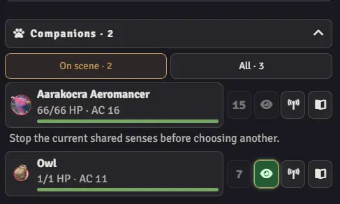

# Журнал изменений

## 2.2.1

### Новое

- **Подсказки пинга:** На кнопках пинга и в выборе токена спутника добавлены подсказки Alt/Shift.

### Изменения и улучшения

- **Карточки:** Обновление карточек предметов и действий требует меньше вычислений.

### Исправления

- **Пинг ГМа:** Пинг существа больше не блокирует другие кнопки и не вызывает принудительное обновление панели.

Документация: [Гайд игрока](docs/player-guide.ru.md) · [Спутники](docs/companions-guide.ru.md) · [Редактор панели](docs/layout-guide.ru.md).

## 2.2.0

### Новое

- **Меню настроек:** Новое меню с разделами объединяет поиск, предпросмотр оформления, руководства и помощь. Изменения можно применять без закрытия окна и видеть, сохранены ли они.
- **Настройка карточек:** Выбирайте, какие данные показывать на карточках предметов и действий, отдельно для игрока и мастера.
- **Фильтр эффектов:** Показывайте все эффекты, только состояния или собственный набор.
- **Оформление:** Настраивайте цвета темы и смотрите пример анимаций ОЗ и начала хода до сохранения.
- **Персонаж и заклинания:** HUD по умолчанию открывает закреплённого за игроком персонажа; можно выбрать другой способ открытия и менять оставшиеся слоты прямо на панели.
- **Статус компаньонов:** Наведение на компаньона показывает его эффекты и состояния.

### Изменения и улучшения

- **Карточки и инвентарь:** Более компактные карточки, встроенные звёздочки избранного, понятные подсказки клавиш и единый блок веса и денег.
- **Компоновка панели:** Больше возможностей настройки расположения и видимости, фильтры, сворачиваемые группы и более удобное использование широких окон.
- **Компаньоны:** Компактное управление, лечение до максимума ОЗ и отдельные настройки камеры и общих чувств.
- **Устранение неполадок:** Запись проблемы находится в диагностическом отчёте; исправление автоматически создаёт копию настроек, а проверка охватывает больше частей модуля.

### Исправления

- **Настройки:** Применение нового языка обновляет открытое меню; восстановленные настройки сохраняются при применении.
- **Карточки:** Shift + ПКМ отправляет предмет в чат, сохраняя быстрый бросок через Shift + ЛКМ. Неподготовленные заклинания в избранном выделены серым, не бросаются по клику и отмечены в подсказке.
- **Совместимость:** Исправлены загрузка переводов и изменение ширины колонок мастера, включая дополнительную.
- **Действия мастера:** Заклинания отображаются и по типу действия, когда включены категории действий и предметов вместе.
- **Оформление:** Улучшены предпросмотр тем, выравнивание элементов и читаемость при разных темах и размерах окна.

Документация: [Руководство игрока](docs/player-guide.ru.md) · [Компаньоны](docs/companions-guide.ru.md) · [Редактор компоновки](docs/layout-guide.ru.md).

## 2.1.0

- Общий редактор компоновки мастера, перемещаемые категории действий и защиты, одна дополнительная колонка, сброс/отмена и адаптивные сетки участников и действий. Новые окна мастера открываются размером 1000 × 450 внизу слева.
- Компактная подготовка боя со сбросом инициативы и удалением участников. Неброшенная инициатива бросается сразу; для повторного броска полностью определённой группы запрашивается подтверждение.
- Перетаскивайте NPC, вложенные папки персонажей или персонажей Encounter из списка персонажей и компендиумов в список существ при подготовке или во время боя. Количество существ Encounter сохраняется; подсказка «Перетащите сюда» сразу показывает место размещения. По умолчанию включено, настраивается в параметрах мастера.
- Следование за ходом и завершение хода используют нативный порядок, включая игроков. Подсветка текущего хода отличается от подсветки просматриваемой карточки; побеждённые существа остаются доступны.
- Пинг, переход к токену, видимость и отметка поражения для каждого существа; раскрытие скрытых NPC и удаление побеждённых требуют подтверждения. Удалённые токены исчезают с панели, а удалённые NPC — из инициативы.
- Поиск рядом с именем мастера, более понятные ОЗ и эффекты, встроенные кнопки листов предметов, перемещаемые закреплённые описания и повторяемые последние действия. Дайс-трей мастера поддерживает нативные режимы видимости бросков.
- Раздел устранения неполадок показывает предполагаемые исправления, сохраняет корректные настройки, создаёт копию исходных данных и исправляет поддерживаемые старые компоновки. Улучшены изменение размера, раскрытие, обновление и обработка устаревших сеансов.

См. [заметки к 2.1](docs/release-2.0.ru.md#изменения-21) ([English](docs/release-2.0.md#21-update)) и [редактор панели](docs/layout-guide.ru.md). Сохранённые настройки имеют приоритет над новыми значениями по умолчанию.

**Планы развития.** После 2.1 ближайшие обновления будут посвящены только исправлению ошибок. Крупных изменений поведения модуля или компоновок HUD не планируется.

## 2.0.0

### Редактор HUD

- Одна кнопка с пером редактирует блоки, вкладки и карточки: перетаскивание/стрелки, размещение по колонкам, скрытие и восстановление, включая инвентарь в обоих режимах. Личные компоновки сохраняют нативный порядок предметов и избранное.

### Поиск по персонажу и дайс-трей

- Перемещаемый поиск охватывает всего персонажа, включая скрытые категории и нативные броски.
- Компактный дайс-трей в нижней панели бросает d2–d100, наборы и формулы через нативный чат, поддерживая быстрый бросок и выбор наибольшего/наименьшего результата.

### Чувства фамильяра и резервные копии

- Необязательный режим «Поиск фамильяра (2024)» проверяет нативный призыв, использует нативную активность бонусного действия и добавляет фильтр фамильяров.
- Резервное копирование и восстановление JSON охватывает личные настройки, компоновки редактора и окна с откатом при ошибке.

### Двухколоночная компоновка игрока по умолчанию

- Сведения о персонаже и броски слева; избранное, компаньоны, поиск и категории действий справа, эффекты и быстрые кнопки ниже. Узкие окна используют одну колонку; сохранённые компоновки и настройки сохраняются.

### Окно и управление

- Компактное управление персонажем, фиксированная нижняя панель, регулируемые колонки, привязка к краям, изменение размера по осям, отдельные размеры режимов и сворачивание окна, включённое по умолчанию.
- Отдельные кнопки категорий при любой ширине; более понятные группы настроек, полные описания и снятие эффектов, все номиналы монет. Компаньоны в исследовании больше не показывают боевую инициативу.

### Исправления и удобство

- Восстановленные компоновки сохраняются после последующих действий и записей в очереди; поддерживаемые старые резервные копии проходят экспорт и импорт без потери данных.
- Полный сброс включает редактор; сброс только окна сохраняет компоновки и нативное избранное.
- Инвентарь использует общий редактор списков; скрытая активная вкладка закрывается, а резервный выбор категории мастера пропускает скрытые вкладки.
- Фокус и прокрутка поиска, группы заклинаний, переходы между компаньонами и очистка сохраняют нативные контракты и контракты сеанса. Обновлены руководства на обоих языках и добавлено отдельное руководство по компаньонам.

См. [подробности 2.0 и заметки об обновлении](docs/release-2.0.ru.md) ([English](docs/release-2.0.md)). Существующие настройки сохраняются; сброс необязателен.

## 1.4.1

- **Компаньоны:** компактный сворачиваемый список принадлежащих вам существ и персонажей с фильтрами **На сцене** и **Все**. Открывайте их действия в том же окне, переключайтесь между компаньонами и возвращайтесь к персонажу по имени. Листы, ОЗ, эффекты и подсветка ходов доступны вместе с индивидуальными и групповыми бросками инициативы. Кнопка группового броска исчезает после броска всех участников; у компаньонов отдельное подменю настроек.
- **Компаньоны на карте:** разместите отсутствующее существо из его прототипа токена при наличии разрешения или отметьте существующий токен пингом. Необязательное следование камеры и зрения токена сохраняет точный токен персонажа при возвращении, в том числе за пределами зрения компаньона.
- **Чувства фамильяра:** зелёная кнопка с глазом добавляет настроенное зрение фамильяра, пока ваш персонаж остаётся выбранным и сохраняет свои действия. Перемещение камеры для общих чувств можно выключить независимо от выбора токена. Продолжительность соответствует «Поиску фамильяра (2024)»: до вашего следующего хода или шесть секунд игрового времени вне боя.

- **Действия существ:** эпические действия, действия злодея и другие типы активации отображаются в соответствующих группах действий мастера. Меню игрока объединяет нестандартные типы, включая минуты и часы, в «Особые». Особенности по умолчанию показывают активируемые способности, с сохраняемым переключением активных и пассивных черт; наведение или фокус клавиатуры показывает описание, которое можно закрепить для долгого чтения.
- **Диагностика:** записывайте проблему до десяти минут, отмечайте сбой и просматривайте или скачивайте ограниченный отчёт с анонимным контекстом, размерами HUD, результатами действий и причинами недоступности кнопок. Автоматической отправки нет; текст ошибок включается по желанию.
- **Исправления:** сохранены нативные преимущество/помеха инициативы, согласованы сведения об источнике сотворения и восстановлены пользовательские категории действий после повторного открытия.
- **Другие улучшения:** просмотр персонажей игроком, упрощённые настройки мастера и управление инициативой, инструменты устранения неполадок, более широкое избранное и вес/золото инвентаря. Исправлены отдых, темы, видимость, фокус клавиатуры и изменение ОЗ после смены существа; убрано автоматическое удаление NPC. Обновлены руководства игрока и мастера.

## 1.3.2

- Добавлено переключение мастера/игрока для мастеров, светлая и тёмная темы, необязательные размеры окна в заголовке.
- Улучшены компактная и широкая компоновки, порядок блоков игрока и управление ходами мастера.
- Добавлены независимые размеры и закрепление окон мастера и игрока; закрытие по Escape необязательно.
- Исправлены кнопки, остававшиеся недоступными после бросков; при обновлении сохраняются раскрытые инструменты, фокус и прокрутка.
- Добавлена скачиваемая диагностика с понятной обратной связью; уменьшено количество лишних обновлений HUD.
- Код HUD разделён на меньшие модули, добавлены проверяемые контракты и расширено покрытие тестами.
- Обновлены руководства игрока и мастера; добавлены режим проверки релиза без публикации и подтверждение перед публикацией.

## 1.3.1

### Боевой HUD мастера

- Добавлен отдельный HUD мастера со своей кнопкой управления токенами и настройками только для мастера. Мастера по умолчанию открывают панель мастера; игроки сохраняют HUD персонажа.
- Переключайтесь между монстрами в порядке инициативы, сразу видьте ОЗ токенов или следуйте текущему ходу. Смена существа сохраняет то же окно HUD.
- Используйте компактную вертикальную компоновку или широкое низкое окно с отдельными колонками. Управление ходами остаётся внизу.
- Бросайте атаки, заклинания и спасброски; просматривайте бонусы атаки, Сл спасбросков, сопротивления, иммунитеты и оставшиеся ресурсы. Дополнительные скорости раскрываются нажатием.
- Используйте легендарное сопротивление через его счётчик и раскрывайте легендарные действия рядом с оставшимся запасом. Действия логова показываются, если они есть у существа.
- Понятные иконки действий и выделенная кнопка начала боя упрощают подготовку столкновения.
- Создавайте бой, добавляйте NPC мастера или все токены текущей сцены, бросайте или перебрасывайте инициативу одного существа или всех, затем начинайте или завершайте столкновение.
- Переходите к токену или отмечайте его пингом, завершайте ход и удаляйте токены побеждённых NPC. Необязательные настройки следуют следующему NPC, автоматически удаляют побеждённых существ и открывают/закрывают панель вместе с боем.
- Добавлены настраиваемые сочетания клавиш Foundry для предыдущего хода, следующего хода и завершения хода. Назначьте их в настройках управления.

> **Место для скриншота 1:** компактный вертикальный HUD мастера с ОЗ токенов, легендарными ресурсами и раскрытыми действиями.

> **Место для скриншота 2:** широкий низкий HUD мастера со списком существ, колонками действий и постоянным управлением ходами.

### Исправления

- Исправлены устаревшие счётчики ресурсов после расходования зарядов и дублирующиеся заклинания NPC.

## 1.2.1

- Ресурсы заменены особенностями после действий. Нажмите особенность, чтобы использовать её активность D&D и настроенное расходование ресурсов.
- Навыки добавлены как боевая вкладка.
- Уровни заклинаний и счётчики ячеек закреплены при прокрутке; следующий уровень заменяет предыдущий заголовок.
- Избранное синхронизируется с листом персонажа, включая современные листы Tidy.
- Урон и лечение ОЗ используют нативную обработку D&D, включая временные ОЗ.
- Наведите на состояние для описания; Shift+ЛКМ по кнопке описания предмета отправляет его описание в чат.
- Добавлена короткая задержка между бросками и действиями персонажа против повторных нажатий.
- Улучшены узкие компоновки ячеек заклинаний и карточек; до раскрытия показывается до пяти состояний.
- Упрощены настройки и добавлена проверка целостности HUD с восстановлением повреждённых сохранённых данных.
- Кнопки режимов можно показать или скрыть в меню окна с тремя точками.
- Исправлены дублирование окон HUD и потеря изменений избранного при быстрых нажатиях.
- Уточнено сопоставление токенов: удалённый участник боя не может перенаправить действия HUD на другой токен того же персонажа.
- Подписи полосы ОЗ показывают пороги здоровья, не подразумевая применение состояния D&D.

## 1.1.1

- Боевые состояния показывают до шести иконок с кнопкой раскрытия остальных.
- Сокращены описания настроек и убраны подсказки, повторявшие видимые подписи кнопок.

## 1.1.0

- Перестроен боевой HUD.
- Добавлена кнопка завершения хода и краткое золотое свечение в начале вашего хода.
- Добавлена личная настройка автоматического открытия HUD при входе или обновлении страницы.
- Двойное нажатие на портрет или имя персонажа открывает его лист.
- Shift+ЛКМ по полосе ОЗ восстанавливает ОЗ до максимума; подходящие заклинания готовятся прямо на карточках, включая D&D 5e 5.3+. Карточки заклинаний показывают A, BA или R для типа действия.
- Оставшиеся ячейки можно исправить прямо в списке заклинаний; обычные и договорные ячейки различаются подписями и цветами.
- Восстановлена кнопка броска инициативы, когда мастер сбрасывает инициативу персонажа для переброса.
- Исправлены дальность оружия, бонус атаки и урон избранных активностей; тип активации убран с карточек предметов.
- Исправлено повторное открытие HUD после смены языка.
- Владение инструментами обновляется при изменении персонажа или его инструментов.

## 1.0.0

- Убран отдельный режим спасбросков от смерти. При 0 ОЗ исследование и бой показывают красную кнопку спасбросков от смерти под полосой ОЗ, подпись «Без сознания» и обесцвеченный HUD; после трёх провалов кнопка показывает сообщение о смерти.
- В дополнительных настройках добавлен личный переключатель анимаций урона, лечения, ОЗ и инициативы, сохраняющий цвета здоровья и подписи состояний.
- Объединены группы с одной настройкой, уточнены описания меню действий; оба README и руководство по адаптеру приведены в соответствие с текущими значениями по умолчанию и проверенной совместимостью.
- Результат инициативы подсвечивается после обновления HUD; общая полоса ОЗ добавлена в исследование.
- Рендерер ОЗ переиспользуется в исследовании и бою; при проверке кода убраны устаревшие селекторы здоровья.
- В навыки исследования добавлен сохраняемый фильтр владения и компетентности, включённый по умолчанию, с переключением на все навыки одним нажатием.
- Добавлён относительный ввод ОЗ: обычные числа задают текущие или временные ОЗ, числа со знаком прибавляют или вычитают; оба значения сохраняются одним обновлением персонажа.
- Добавлен личный язык Adventurer HUD: автоматически, английский или русский, независимо от языка интерфейса Foundry.
- Исправлены живые обновления HUD после изменений боя и бросков инициативы, включая отсутствовавшую ссылку на функцию обновления исследования.
- Исправлено сохранение текущих и временных ОЗ в диалоге, в том числе при исходных нулевых временных ОЗ; объединённая полоса ОЗ надёжно видна.
- Усилена видимость вспышек урона и лечения, упрощены карточки проверок и спасбросков, ресурсы классов перемещены вниз боевого HUD.
- Настройка группировки типов действий заменена настройкой видимости сгруппированного меню типов действий.
- Меню дополнительных настроек и сброса переведены на выбранный язык HUD; уточнено, что настройка кнопки управления токенами действует после перезагрузки страницы.
- Отрицательный ввод ОЗ сначала расходует временные ОЗ, затем обычные; золотая вспышка инициативы добавлена только при вступлении текущего токена в бой без инициативы.
- Добавлены локальный отклик изменения ОЗ, отметки половины здоровья и критического состояния, подсветка результата инициативы, выделение хода и понятная подпись отсутствия зарядов на карточках предметов.
- Проверены затронутые настройки, хуки боя, ввод ОЗ и отображение спасбросков от смерти; добавлены целевые тесты поведения.

## 0.15.1

- Повторяющиеся сетки проверок и спасбросков заменены шестью карточками характеристик с прямыми кнопками спасброска и проверки.
- Избранное сделано сворачиваемым; инициатива и вдохновение исследования перемещены рядом с отдыхом.
- Текущие и временные ОЗ объединены в одну компактную полосу и один диалог изменения; Enter сохраняет оба значения.
- Добавлены мягкие вспышки границы при уроне и лечении; при половине здоровья полоса ОЗ становится красной, при меньших значениях — более тёмно-красной.
- Добавлена настройка объединения типов действий в одно меню; пустые боевые категории скрыты.

## 0.13.1

- Проверки характеристик и спасброски объединены в сворачиваемую матрицу в исследовании и бою; оба типа бросков доступны одним нажатием.
- Боевые ОЗ преобразованы в заметную карточку с точным значением, полосой здоровья и отдельным компактным индикатором временных ОЗ; КД и скорость остаются рядом.
- Боевое избранное и действия перемещены над справочными бросками и ресурсами; крупные ссылки режимов заменены компактным переключателем.
- Снижен визуальный вес второстепенных карточек, улучшены мелкие подписи; дальность предмета, активация, расходы ресурсов и оставшиеся использования показаны прямо на карточках действий.

## 0.12.0

- Добавлен живой поиск по боевым действиям, заклинаниям и инвентарю по названиям предметов и активностей с сохранением запроса при смене категории.
- Добавлен встроенный выбор для предметов с несколькими доступными активностями D&D 5e. Выбранная активность использует нативный процесс системы; Shift+ЛКМ сохраняет нативный быстрый вызов предмета.
- Добавлено личное избранное для предметов и отдельных активностей каждого персонажа, доступное в исследовании и бою.
- Восстановлены дополнительные настройки с отдельным управлением поиском, избранным и выбором активности; настройки сгруппированы по быстрому доступу, использованию предметов, управлению окном и спасброскам от смерти.
- Предметы с разными типами активации активностей могут отображаться в каждой соответствующей боевой категории.

## 0.11.0

- Ручная навигация режимов перенесена в основные настройки модуля Foundry; экран дополнительных настроек и его шаблон удалены.
- Удалены настройки заголовков режимов, автоматического боя и адаптивной компоновки. Заголовки остаются видимыми, бой определяется автоматически, HUD всегда использует адаптивную компоновку.
- Исправлены устаревающие характеристики персонажа после изменений активных эффектов, взаимное скрытие ресурсов с одинаковыми названиями и отсутствие резервной подписи расходов ресурсов.
- Действия HUD и жизненный цикл окна вынесены из контроллера приложения; боевые предметы и состояния разделены на специализированные рендереры; удалён неиспользуемый путь обновления только состояний.
- Стили HUD разделены на упорядоченные файлы диалогов, основы, боя, общих элементов, спасбросков от смерти и адаптивности.
- Локальный документ контекста сопровождения исключён из Git.

## 0.10.1

- Необязательная кнопка управления токенами выключена по умолчанию; её можно включить в настройках модуля.
- Настройка удержания окна открытым заменена необязательным закрытием после броска.
- Убраны избыточные настройки видимости исследования и боя; поддерживаемые разделы всегда доступны, если их предоставляет активный системный адаптер.
- Удалены устаревшие миграции настроек и старые ключи хранения перед публичным релизом.

## 0.10.0

- Настройки видимости и поведения применяются к открытому HUD без сброса текущего представления, фильтров или раскрытых разделов.
- Обновления документов Foundry объединяются в одно приоритетное обновление за кадр; очистка хуков централизована.
- Выбор персонажа, геометрия окна, управление заголовком, боевые ресурсы и обновление настроек выделены в специализированные модули.
- Повторяющиеся списки настроек заменены одной декларативной схемой; расширено экранирование данных системного адаптера.
- Проверка локализации автоматически находит каждый исходный файл JavaScript.

## 0.9.3

- Исправлена отдельная кнопка закрепления в заголовке; добавлены проверки её размещения, состояния и обработки Escape.

## 0.9.2

- В бой добавлен свёрнутый по умолчанию раздел проверок характеристик; закрепление перенесено из меню заголовка в отдельную кнопку, показывающую состояние.
- Небольшие исправления.

## 0.9.1

- Монолит HUD разделён на специализированный контроллер приложения, общие компоненты и отдельные рендереры исследования, боя и спасбросков от смерти.
- Персонаж HUD сохраняется при обновлении из-за настроек; пользовательские подписи состояний экранируются, действие закрытия диалога переведено.
- Расширены регрессионные проверки адаптера и рендереров для изоляции системы, формул урона, ресурсов, ячеек заклинаний, делегирования бросков и разметки состояний.
- Быстрые вызовы преимущества и помехи инициативы передаются через адаптер D&D без создания участников боя.
- Добавлены сворачиваемые проверки исследования и боевые спасброски, раскрытые по умолчанию; улучшены узкие карточки ресурсов и добавлено необязательное закрепление окна, защищающее от Escape.
- Размеры текста приведены к малому, среднему, большому и очень большому с переносом существующих настроек в соответствующий визуальный масштаб.
- Сводка мультикласса больше не сталкивается с кнопками заголовка при узкой ширине; полная сводка остаётся в подсказке.
- Обычный режим переименован в исследование, добавлена настройка видимости кнопки управления токенами, расширена документация пользователя и адаптера.

## 0.9.0

- В исследование добавлен просмотр инвентаря с фильтрами «Надето», «Расходуемое» и «Прочее».
- В карточки инвентаря и боя добавлены индикаторы оставшихся зарядов для предметов с ограниченными использованиями.
- Добавлены необязательная видимость инвентаря и его локализация на английский/русский.
- Добавлены проверки адаптера D&D 5e для категорий инвентаря и данных зарядов в форматах предметов 5.3 и 6.x.
- Добавлен публичный реестр системных адаптеров с интерфейсом по доступным возможностям и безопасными значениями по умолчанию для неподдерживаемых механик.
- Доступ к данным D&D, броски, использование предметов, ресурсы, отдых и нормализация боя перенесены за границу встроенного адаптера D&D 5e.
- Добавлены документация для разработчиков и контрактные тесты будущих интеграций игровых систем.

## 0.8.7

- В HUD исследования добавлена инициатива персонажей, уже включённых в столкновение, в том числе до начала боя.
- Исправлен очень большой размер текста; подсказки клавиш ресурсов классов согласованы с остальными подсказками HUD.
- Следование выбранному токену перенесено в основные настройки, подсказки клавиш — в дополнительные; дополнительные настройки и сброс остаются внизу раздела модуля.
- Метаданные манифеста Foundry VTT 14 дополнены типом пакета и ссылками на проект, документацию, поддержку, лицензию, автора и медиа.
- Добавлены регрессионные проверки инициативы исследования, текста, подсказок ресурсов, размещения настроек и URL манифеста релиза.

## 0.8.6

- Исправлено приложение настроек Foundry V14; общие параметры восстановлены непосредственно в настройках модуля, подробные — в дополнительных настройках.
- Добавлен сброс к значениям по умолчанию; следование выбранному токену стало необязательным.
- Исправлено снятие концентрации, добавлено полное восстановление ресурсов и быстрые изменения ресурсов через Shift+ЛКМ.
- Свободный редактор компоновки заменён его полезными явными настройками видимости заголовков режимов, боевых характеристик и активных состояний.
- Сохранён ручной доступ к режиму спасбросков от смерти до их активации; расширены регрессионные проверки шаблонов настроек и состояния HUD.

## 0.8.5

- Выделены адаптеры персонажей и предметов D&D 5e с учётом версий и отдельными примерами 5.3 и 6.x.
- Три флага ручного режима заменены одним явным состоянием HUD; выбор режима централизован.
- Схемы компоновок и нормализация сохранённых компоновок централизованы.
- Добавлены диспетчеры режимов и представлений исследования; представления исследования подключаются по одному.
- Добавлены целевые обновления активных состояний и фильтров боевых действий, полные обновления сохранены для структурных изменений.
- Плоский список настроек Foundry заменён сгруппированным приложением настроек Adventurer HUD с сохранением существующих ключей и предпочтений пользователя.
- Расширены регрессионные проверки адаптеров совместимости, приоритета режимов, переключения представлений, компоновок и групп настроек.
- Документация проекта упрощена; добавлен полный русский README со взаимными ссылками языков.

## 0.7.9

- Исправлено автоматическое отслеживание персонажа: смена или снятие выбора токена обновляет полный контекст персонажа и токена.
- Разрешены броски инициативы принадлежащего пользователю персонажа при известном участнике боя без требования сохранять выбор токена.
- Предотвращено восстановление ресурсов без конечного максимума; ограничение значений ресурсов централизовано.
- Учёт миграции перенесён на уровень пользователя; существующее предпочтение ручной навигации больше не перезаписывается.
- Добавлены регрессионные тесты контекста токена, выбора участника боя, границ ресурсов, настроек по умолчанию и миграций.

## 0.7.8

- Добавлен сворачиваемый раздел спасбросков, раскрытый по умолчанию.
- В исследование добавлен просмотр заклинаний с фильтром подготовленных/всех.
- Вдохновение оставлено рядом с данными персонажа; отдых перемещён под заголовок исследования.
- Управление активными состояниями уменьшено до компактных кнопок-иконок.
- Добавлено восстановление ресурсов вместе с их расходованием.
- Определение инициативы активного боя стало устойчивым к пересозданию боя.
- Вложенная прокрутка списков действий заменена общей полосой прокрутки окна HUD.
- Увеличен очень большой размер текста.
- Подтверждено, что ручная навигация режимов скрыта по умолчанию, а английский служит резервной локализацией.

## 0.7.5

- Исправлен выбор принадлежащего пользователю персонажа при открытии HUD без выбранного токена.
- Боевые спасброски компактной компоновки и фильтры боя при минимальной ширине используют две колонки.
- Просмотр состояний заменён удаляемыми элементами текущих активных состояний.
- Добавлены редактируемые карточки текущих и временных ОЗ; временные ОЗ видны и при нуле.
- Ручная навигация режимов выключена по умолчанию.

## 0.7.0

- Добавлен постоянный личный редактор компоновки с перетаскиванием разделов, скрытием/добавлением и доступом ко всем режимам HUD при редактировании.
- Действие настроек в меню заголовка открывает непосредственно категорию Adventurer HUD.
- Переменные данных броска подставляются в формулы урона; добавлен модификатор характеристики оружия, когда D&D 5e применяет его неявно.
- Подпись боевых спасбросков перемещена над кнопками для уменьшения горизонтального места.
- Добавлены диалоги расходования ресурсов особенностей классов и пользовательских ресурсов персонажа.
- Ресурсы классов сворачиваются в узких боевых компоновках.

## 0.6.7

- Вложенная прокрутка с высотой в процентах заменена нативной прокруткой содержимого окна Foundry.
- Добавлен выбор принадлежащего пользователю персонажа при отсутствии выбранного токена.

## 0.6.6

- Исправлено сжатие разделов HUD почти до нулевой высоты при изменении размеров окна.
- Восстановлена удобная вертикальная прокрутка всего окна в каждом режиме.

## 0.6.5

- Добавлен свёрнутый по умолчанию выбор состояний с включением/выключением и отдельными кнопками снятия активных состояний.
- Исправлены живые обновления состояний и ресурсов особенностей классов.
- Расходуемые особенности классов, включая очки фокуса, добавлены в боевые ресурсы при наличии ограниченных использований.
- В карточки оружия и заклинаний добавлены бонусы атаки и формулы урона.
- Добавлена информация о классе и уровне персонажа, включая сводки мультикласса.
- Управление героическим вдохновением добавлено в каждый режим, короткий/продолжительный отдых — в исследование.
- Режим спасбросков от смерти доступен вручную и вне нулевых ОЗ, но броски остаются ограничены состоянием персонажа.
- Навигация режимов размещена непосредственно под заголовком персонажа; добавлена настройка скрытия ручной навигации.
- Улучшена вертикальная прокрутка всего HUD, навыков, инструментов, выбора состояний и списков боевых предметов.
- Проверены настройки; отдельные параметры видимости сохранены там, где влияют на независимые разделы HUD.

## 0.6.0

- Адаптивные сетки переработаны: в широких окнах управление получает дополнительные колонки вместо чрезмерного растяжения.
- Добавлена прокрутка всего окна и независимая прокрутка списков боевых предметов.
- Добавлены выбор размеров шрифта HUD и более крупные, понятные кнопки характеристик.
- Боевая инициатива перемещена рядом с именем персонажа, убрана из исследования; неброшенная инициатива выделена.
- Временные ОЗ и модификаторы максимальных ОЗ скрыты при нуле.
- Добавлены карточки ресурсов классов/пользовательских ресурсов и настройки видимости каждого боевого раздела.
- Заклинания сгруппированы по уровням с фильтром подготовленных/всех и индикаторами ячеек.
- На карточки действий добавлено определение расходов ресурсов по доступным данным.
- Добавлены живые обновления активных эффектов и непосредственное снятие состояний.
- Добавлена согласованная навигация между исследованием, боем и спасбросками от смерти.
- Убраны избыточные подзаголовки режимов под именами персонажей.

## 0.5.0

- Добавлены необязательные адаптивная компоновка и адаптивный размер текста.
- Улучшены узкие боевые компоновки фильтров, предметов, характеристик и спасбросков.
- Добавлены минимальные ширины адаптивной и фиксированной компоновок.
- Удержание открытым и сброс окна перенесены в меню заголовка.
- Добавлены настраиваемые сведения на боевых карточках: дальность заклинаний и оружия, активация, концентрация и ритуалы.
- Добавлены кнопки описания оружия, заклинаний, особенностей и других боевых предметов.
- Настраиваемое сочетание клавиш Foundry открывает и закрывает HUD.

## 0.3.1

- Синхронизированы русские и английские словари локализации.
- Настройки HUD добавлены в меню управления окном.
- Боевой режим доступен вручную вне активного столкновения.
- Добавлены показатели временных ОЗ и модификатора максимальных ОЗ.
- Боевые навыки и инструменты заменены фильтрами оружия, заклинаний и действий.
- Добавлены отображение активных состояний и их снятие владельцем.

## 0.3.0

- Портрет и данные персонажа добавлены в каждый режим HUD.
- Добавлен автоматический боевой режим с боевыми характеристиками и возвратом к исследованию.
- Все комментарии исходного кода переведены на английский.
- Добавлены локальная валидация, линтинг, тесты, упаковка релиза и процессы GitHub Actions.
- Добавлена первоначальная локализация боевого интерфейса.

## 0.2.0

- Постоянное состояние HUD перенесено в пользовательские и клиентские настройки Foundry.
- Добавлены кнопка управления токенами и сочетание `Shift+R` по умолчанию.
- Добавлена автоматическая смена персонажа при смене выбранного токена.
- Завершена английская и русская локализация HUD и уведомлений.
- Добавлены личные настройки видимости разделов HUD.
- Добавлен однократный перенос значений локального хранилища прежнего макроса.

## 0.1.0

- Добавлен первоначальный каркас модуля Foundry VTT.
- Рабочий макрос разделён на загрузку, логику HUD, константы, стили и шаблоны.
- Добавлены назначаемое сочетание клавиш и публичный API `open()`.
