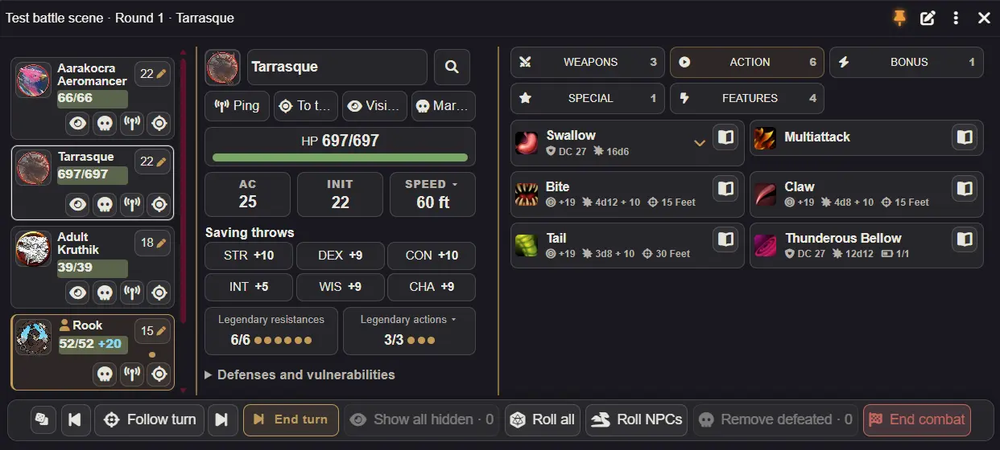
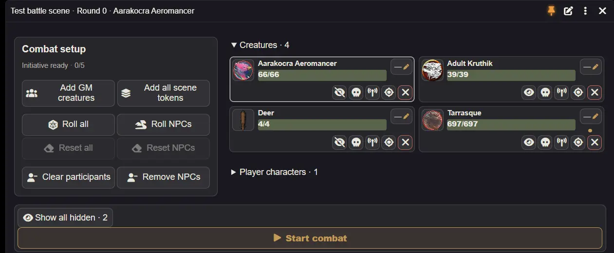

# HUD мастера

[О модуле](../README.ru.md) · [Гайд игрока](player-guide.ru.md) · [Спутники](companions-guide.ru.md) · [Редактор компоновки](layout-guide.ru.md) · [English](gm-guide.md)

Включите **Использовать панель GM** в **Настроить → Панель GM**, затем нажмите **Shift+R**. Меню окна открывает настройки и позволяет переключиться в режим игрока.

## Подготовка сражения

Выберите сражение, добавьте существ и бросьте инициативу. Можно добавить токены сцены или перетащить NPC, папки персонажей и Encounter в список существ. Выберите места для новых токенов; при необходимости отмените размещение.

Нажмите на значение инициативы, чтобы бросить или изменить её. При подготовке также доступны сброс инициативы и удаление участников. Удаление участника из сражения оставляет его токен на сцене. Когда всё готово, нажмите **Начать бой**.

## Ходы и существа

**Следовать за ходом** открывает текущего участника. Нажмите на другое существо, чтобы просмотреть его вручную; текущий ход остаётся выделенным. **Завершить ход** продвигает бой в порядке Foundry.

Нажатие на имя существа открывает его лист. Кнопки позволяют поставить пинг, перейти к токену, изменить видимость и отметить поражение. Удаление побеждённого NPC может удалить его токен со сцены; прочитайте подтверждение перед продолжением.

Нажмите **ОЗ** для урона или лечения; Shift+ЛКМ восстанавливает здоровье до максимума. Наведите на карточку участника, чтобы увидеть эффекты. В категориях действий используйте способности, заклинания и ресурсы через обычные диалоги D&D. ПКМ по карточке открывает её лист, Shift+ПКМ отправляет описание в чат.

## Настройка панели

Настройки мастера позволяют выбрать поведение панели, видимые кнопки и данные карточек независимо от настроек игрока. Оформление применяется также к панели мастера и кубикам.

Перо позволяет перемещать и скрывать блоки; подробнее — в [гайде редактора](layout-guide.ru.md). В панели кубиков можно выбрать, кто увидит бросок.

Резервные копии, исправление настроек и диагностические отчёты описаны в разделе [Резервная копия и помощь](player-guide.ru.md#резервная-копия-и-помощь).
