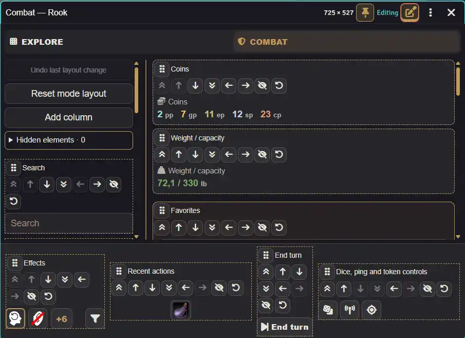
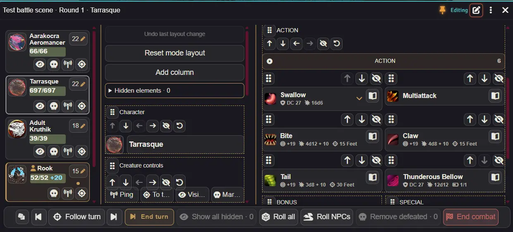

# HUD layout editor

[Player guide](player-guide.md) · [GM guide](gm-guide.md) · [Русский](layout-guide.ru.md)

Click the pen beside the pin to enter **Edit HUD**. Cards change their layout instead of using abilities while editing.

## Arrange the panel

- **Move:** drag a block by its handle or use arrows to change its position. Top/bottom buttons move it to either end.
- **Columns:** left/right arrows move blocks between columns. Add an extra column from the editor toolbar if needed.
- **Width:** unpin the window and drag the dividers to resize columns. Narrow windows stack content.
- **Cards and categories:** use their own controls to rearrange them.

Weight and coins stay together inside Inventory. You can hide or show that block, but cannot move it.

## Hide, restore and undo

Use the eye to hide an element. Restore it from **Hidden elements**, or from the hidden-card/category controls in its list.

**Undo** returns the last edit during this editing session. **Reset layout** returns the current mode's layout to its defaults. Leave editing to return to normal use; your layout is kept.

## Shared layouts

Player block layouts are shared across characters by default, with separate layouts for Exploration and Combat. Enable **Separate layout for each character** if you prefer individual layouts.

GM block layouts are shared across creatures, with separate preparation and combat layouts. Editing the HUD does not reorder items or change favorites in the character sheet.

