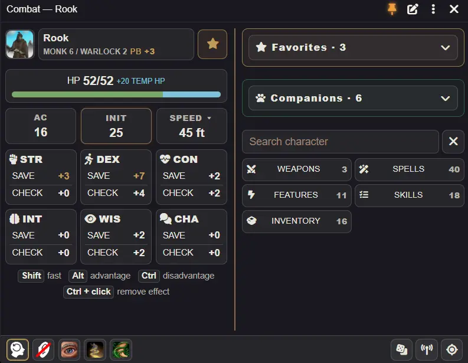

# Player HUD

[About](../README.md) · [GM guide](gm-guide.md) · [Companions](companions-guide.md) · [Layout editor](layout-guide.md) · [Русский](player-guide.ru.md)

## Open the panel

Select your character's token and press **Shift+R** to open or close the HUD. Without a selected token, the HUD uses your assigned character by default; change this in **Character when opening HUD**. Click the portrait or name to open the character sheet.

The pin locks the window in place. Unpin it to move or resize it. Open **⋮ → HUD Settings** to customize the panel.

## Exploration and combat

Exploration brings together checks, saves, skills, spells, inventory and rest. In combat, open the category you need: weapons, spells, actions or features. Click its heading again to collapse it.

Click a check, save or action to use the usual D&D dialog. Click **HP** to apply damage, healing or a new total; Shift-click HP to restore full health. Temporary HP can be set separately.

## Find and use actions

Search finds your character's items, actions and skills. Use stars to keep frequently used actions in **Favorites**. Unprepared spells there are grey and cannot be cast by clicking until prepared.

- **Right-click a card:** open its sheet.
- **Shift-right-click a card:** send its description to chat.
- **Hover over a card:** read its description and shortcut hints. Pin a description to keep it open.

Filter spells by preparation or source, and click a slot counter to change the remaining slots. Feature groups can be collapsed, and active and passive features can be viewed separately.

Inventory shows your items, weight and coins. Click the weight and coins block to open the character's inventory. Recent actions let you repeat an action from the panel.

## Dice tray

Open the dice button in the bottom toolbar. Left-click a die to add it, right-click to remove it, or enter a formula such as `2d6 + 3`. Click **Roll** to roll or **Clear** to start over.

## Window and settings

The new settings menu groups related options into sections. Use search to find a setting, or click a parent section to open its subsections.

- **Appearance:** choose a theme, colors, text size and animations; preview them before saving.
- **Panel content:** choose visible sections, card details and which effects to display.
- **Behavior and layout:** choose how characters open and whether they share a layout.
- **Companions:** adjust companion control and shared senses.

**Apply** saves without closing; **Save and close** does both. The Saved/Unsaved indicator shows whether you have pending changes. Guides, release notes and feedback links are available in the same menu.

Use the pen beside the pin to rearrange or hide elements. See the [layout editor](layout-guide.md) for the main controls.

## Backup and help

Open **Troubleshooting** to download or restore a settings backup. **Check and repair** can fix supported settings problems after confirmation and automatically downloads a copy of the original settings.

**Reset player settings** resets preferences. **Reset entire HUD** also clears saved layouts and window positions; character-sheet favorites remain.

To report a problem, open **Diagnostic report**, start recording, reproduce it, then stop and download the report. Review it before sharing; nothing is sent automatically.
